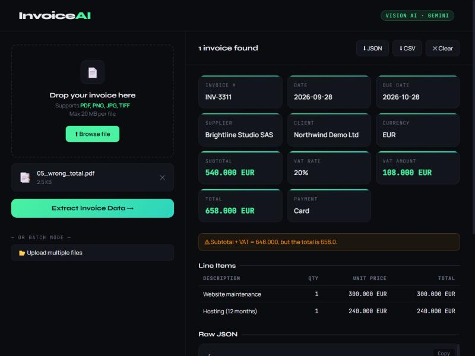

# InvoiceAI


Turns invoice PDFs and images into structured data (JSON / CSV) with a vision LLM, and **flags invoices whose numbers don't add up**.

Built for French and English invoices, including Tunisian ones (TND with 3 decimals, 19% VAT, *timbre fiscal*).



*An invoice whose printed total is wrong: the fields are extracted and the totals check flags the 10 EUR gap.*

## How it works

```
PDF / image ──► type check (by content) ──► vision LLM ──► Pydantic validation ──► totals checks ──► JSON / CSV
                                             (Gemini or Groq)  (1 retry if invalid)    (line items, VAT, total)
```

1. **Upload**: the file type is detected from its bytes, not its name; size is capped while reading.
2. **Extraction**:
   - **Gemini** (default, free tier) reads the whole PDF in one call, with the invoice schema as structured output.
   - **Groq** (Llama 4 Scout vision) reads one page image at a time.
3. **Validation**: the answer must match the schema in [`schema.py`](schema.py). Invalid output is retried once, then reported as an error, never silently dropped.
4. **Accounting checks** ([`checks.py`](checks.py)):
   - quantity × unit price = line total;
   - line totals = subtotal;
   - subtotal × VAT rate = VAT amount;
   - subtotal + VAT (+ stamp duty) = total.

   The model can misread a digit; these checks catch it so a human looks before the data is used.

## Results

Measured with [`scripts/evaluate.py`](scripts/evaluate.py) on the 5 fictional samples in [`samples/`](samples). These are 6 invoices, including a two-invoice PDF and a blurred, rotated scan.

| Model | Field accuracy | Field checks | Time per file | Wrong total flagged |
|---|---|---|---|---|
| gemini-3.5-flash-lite | **100%** | 153 | 3.2 s | ✓ (and no false alarms) |

Full report: [`eval/report.md`](eval/report.md).

**Limits, honestly:** the samples are clean, generated documents, so 100% here does not mean 100% on real invoices. Real ones vary much more:
- handwriting;
- stamps over text;
- low-quality phone photos;
- unusual layouts.

The next step would be a larger test set of anonymised real invoices.

## Run it

```bash
git clone https://github.com/FAROUK-debug/invoice-ai.git
cd invoice-ai
python -m venv .venv
.venv\Scripts\activate          # macOS/Linux: source .venv/bin/activate
pip install -r requirements.txt
copy .env.example .env          # macOS/Linux: cp .env.example .env
```

Then:
1. Put a free Gemini key in `.env` (get one from [Google AI Studio](https://aistudio.google.com/apikey)).
2. Start the server:

   ```bash
   uvicorn main:app
   ```
3. Open http://127.0.0.1:8000.

With Docker:

```bash
docker build -t invoice-ai .
docker run --env-file .env -p 127.0.0.1:8000:8000 invoice-ai
```

## API

| Method | Path | Description |
|---|---|---|
| POST | `/api/process` | One file → invoices, warnings, `result_id` |
| POST | `/api/batch` | Up to 10 files |
| GET | `/api/download/{result_id}?format=json\|csv` | Download a saved result |
| GET | `/health` | Status, provider and model |

```bash
curl -F "file=@samples/01_tn_facture_simple.pdf" http://127.0.0.1:8000/api/process
```

## Security

- **Uploaded files** are processed in memory and **never written to disk**.
- **Results** are saved under a random 32-hex id, and only that exact id can be downloaded, so there's no path traversal.
- **Model output is untrusted.** Every value is escaped before it's shown in the page, so a crafted invoice can't inject HTML or JavaScript (no XSS).
- **Server access:**
  - The server listens on `127.0.0.1` only.
  - It has no cross-origin (CORS) access.
  - It sends security headers.
  - Errors don't leak internal details.
- **Logs** record counts and timings only, never invoice content.
- **API keys** stay in `.env`, which git ignores.

These are covered by tests in [`tests/test_app.py`](tests/test_app.py).

## Tests and samples

```bash
pip install -r requirements-dev.txt
pytest                          # 18 tests, no API key needed (the model call is faked)
python scripts/make_samples.py  # regenerate the fictional sample invoices + expected answers
python scripts/evaluate.py      # measure accuracy (uses your API key: 1 call per file)
```

All companies, people and numbers in `samples/` are invented.

## Project layout

```
main.py          FastAPI app: upload, validation, download, security headers
extractor.py     Gemini / Groq providers, parsing, retry
schema.py        Invoice schema (Pydantic + JSON Schema for Gemini)
checks.py        Accounting consistency checks
static/          Single-page web UI (vanilla JS)
scripts/         Sample generator and evaluation
samples/         Fictional invoices + expected JSON
tests/           pytest suite (runs in GitHub Actions)
```

## Tech

Python · FastAPI · Pydantic · Google Gemini (google-genai) · Groq · pypdfium2 · Pillow · ReportLab · pytest · GitHub Actions · Docker
